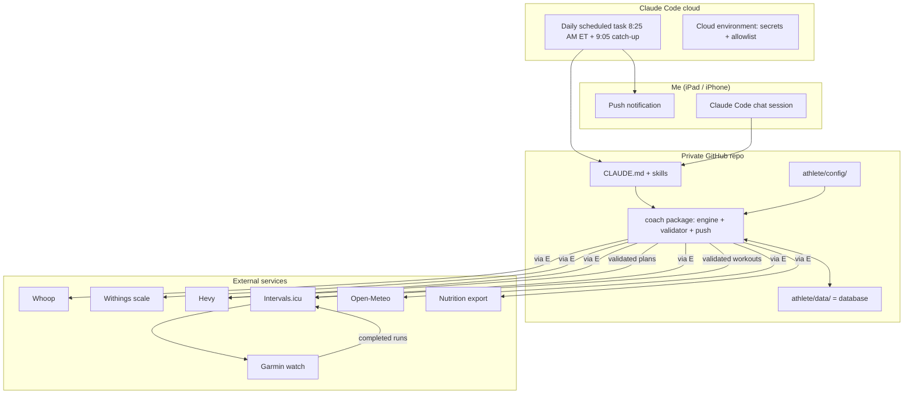
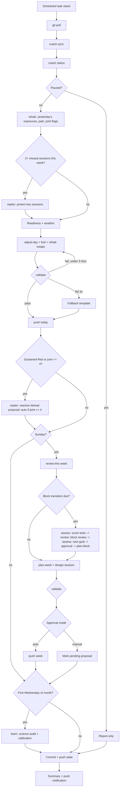
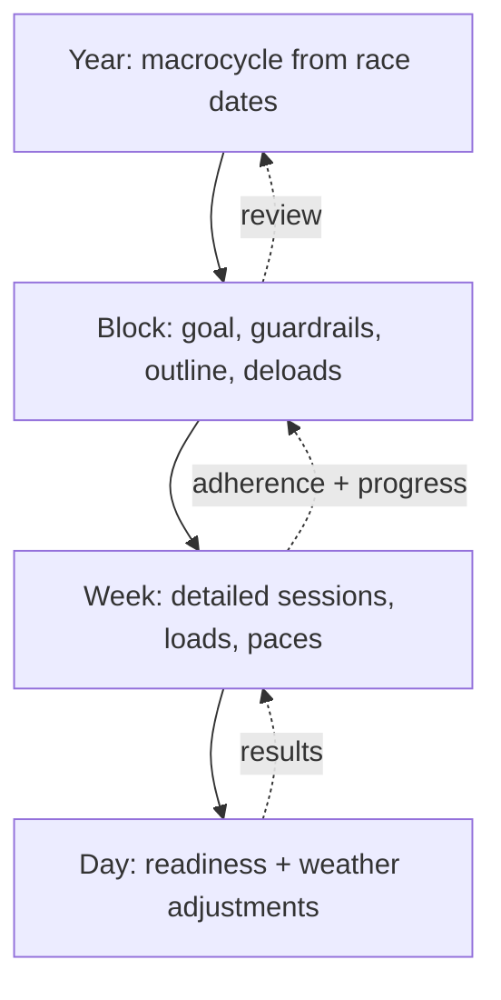
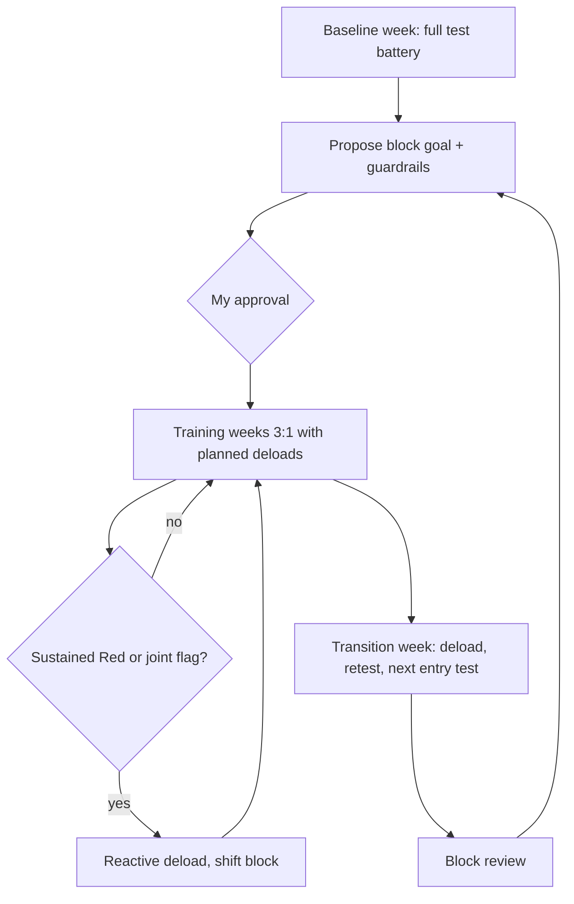
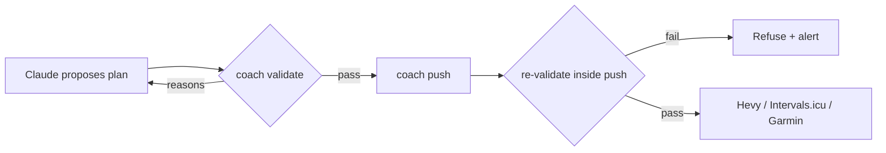
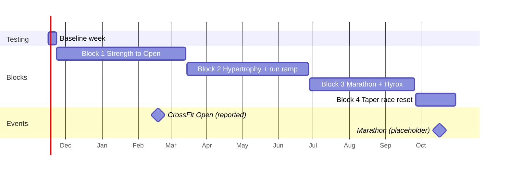

# Architecture

Diagrams from the build brief, updated where the implementation differs (noted under each).

## Architecture

Whoop and Withings are reached through a small token broker (Phase 2) that holds their rotating refresh tokens.

## Daily run

Differences from the brief: rehab runs before adjust-day (rung changes must be known before today's swaps);
the block transition runs *before* the Sunday plan-week, because the new block's first week needs its outline;
missed-session replans and reactive deloads are explicit steps.

## Planning layers


## Block lifecycle


## Safety path


## Year timeline (as generated)

Block 1 ends one week after the last Open workout (`season.yaml` B1 `end_after_event.weeks_after: 1`), not two; see DECISIONS.md.

## Code map

One repo, three clearly separated concerns: **code** (`src/coach/`, `.claude/skills/`), **integrations**
(`src/coach/integrations/`), and **the athlete** (`athlete/config/` settings + `athlete/data/` records, the would-be
database). Data model and collections: `docs/DATA_MODEL.md`.

```
src/coach/
  models/        schemas (Pydantic, extra="forbid"): plans, metrics, journal, records, profile, season/training config
  store/         the only reader/writer of athlete/data (collection registry + file backend)
  config.py      loads + cross-checks athlete/config
  integrations/  base ABCs, normalize (raw -> models), mock, live, sync (in), push (out)
  engine/        calculations (readiness, loads, paces, weather, nutrition, macrocycle, deloads, running, testing,
                 movement, gear, parsing) + validator; pure functions, no I/O
  coaching/      daily (coordinator), context, fill (loads/paces), proposals, notify,
                 skills/ (deterministic stand-in per skill; templates.py builds sessions from training.yaml)
  sim/, demo/    simulated athlete + demo athlete config/fixtures for tests and `coach simulate`
  cli.py         `python -m coach ...`
```

| Module | Role |
|---|---|
| `coach/models/` | Row schemas for every collection; Claude-written JSON must parse into them |
| `coach/store/` | `Store`: typed access by collection (`get/put/query/keys/report`), metrics series, rendered views |
| `coach/integrations/sync.py` | Incremental, idempotent sync; merges Whoop + Hevy + Intervals into one session record |
| `coach/integrations/push.py` | Hevy routines + Intervals events; always re-validates; dry-run unless `push.enabled` |
| `coach/engine/validator.py` | Every guardrail, with stable rule codes |
| `coach/coaching/fill.py` | Fills loads (e1RM -> rounded implement) and paces/HR (zones) into plans |
| `coach/coaching/proposals.py` | Proposals (targets are `collection/key` refs), approve/reject, config lock + changelog |
| `coach/coaching/skills/` | Deterministic stand-in for each skill (used after 3 failed validations and in simulation) |
| `coach/coaching/daily.py` | The coach-daily flow in deterministic mode (`coach daily --fallback`, simulation) |
| `coach/sim/` | Simulated athlete, 120-day replay, per-skill scenarios |

### Where the season and sessions come from
`athlete/config/season.yaml` blocks are laid out by `engine/macrocycle.py` (forward from the season start, backward
from the race-anchored last block, one `fill` block in between). `coaching/skills/plan_block.py` turns a block spec
into an outline; `coaching/skills/plan_week.py` picks the week template for the week type (then applies the
athlete's `availability`), and `coaching/skills/templates.py` builds each session from its template (fixed items
resolve to the current rung; generators size runs, pick metcons and skill drills).

### Data sources
- **Whoop (direct API via a token broker)**: recovery, HRV, RHR, sleep, day strain, and HR/strain for *every*
  session (it's worn 24/7; the Garmin only on runs).
- **Intervals.icu**: run detail from the Garmin (pace, Running Dynamics), training load, shoe mileage, custom
  check-in fields, and the route for planned run workouts onto the watch.
- **Hevy**: lifting sets and routines. **Withings** (via the broker): weight and body fat. **Open-Meteo**: weather.
