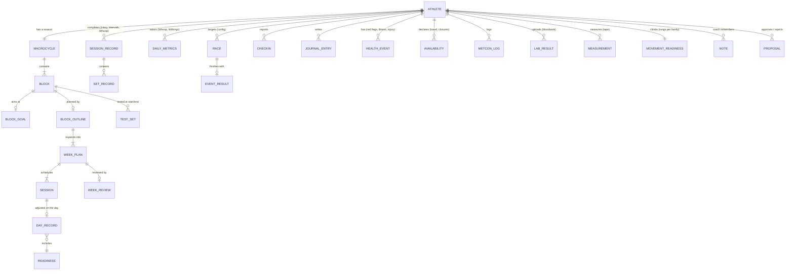

# Data model

Everything about the athlete lives under `athlete/`, separate from the code:

| Layer | Where | What | Changes how |
|---|---|---|---|
| **Coaching** | `src/coach/coaching/` (+ `.claude/skills/`) | the daily coordinator, planning context, proposals, notifications, deterministic skill stand-ins | code |
| **Engine** | `src/coach/engine/` | calculations and the validator (pure functions, no I/O) | code |
| **Integrations** | `src/coach/integrations/` | Whoop, Hevy, Intervals.icu, Withings, Open-Meteo, nutrition; `sync` (in) and `push` (out) | code |
| **Data model** | `src/coach/models/` | Pydantic models = the row schemas | code |
| **Store** | `src/coach/store/` | the only reader/writer of athlete data; collection registry | code |
| **Athlete config** | `athlete/config/` | settings the athlete edits: profile, season shape, session templates, gym, library, thresholds | editing files (threshold changes need an approved proposal) |
| **Athlete data** | `athlete/data/` | records the coach and the athlete create over time | only through `coach.store` (`coach record`, `coach log`, the skills) |

Today the store's backend is files in git. Every read and write goes through a named collection
(`src/coach/store/collections.py`), so moving to a database means writing one new backend: each collection below
becomes a table (the model is the schema, the key is the primary key), and nothing else in the code changes.
`coach collections` prints this registry; `coach record add|list|get <collection>` is the generic client.

## Entities

## Collections

| Collection | Kind | Model | Path today | What |
|---|---|---|---|---|
| **athlete-reported** | | | | |
| `checkins` | doc | `Checkin` | `athlete/data/checkins/{key}.json` | check-ins entered in chat, by date |
| `journal` | doc | `JournalEntry` | `athlete/data/journal/{key}.json` | athlete journal entries |
| `metcon_logs` | doc | `MetconLog` | `athlete/data/metcons/{key}.json` | mixed-modal results, by date |
| `health_events` | doc | `HealthEvent` | `athlete/data/health/{key}.json` | red flags, illness, injuries |
| `availability` | doc | `Availability` | `athlete/data/availability/{key}.json` | travel, gym closures, busy days |
| `lab_results` | doc | `LabResult` | `athlete/data/labs/{key}.json` | bloodwork markers |
| `measurements` | doc | `Measurement` | `athlete/data/measurements/{key}.json` | tape measurements |
| `event_results` | doc | `EventResult` | `athlete/data/events/{key}/result.json` | race / competition results |
| `intake` | singleton | `Intake` | `athlete/data/athlete_intake.json` | intake questionnaire |
| `nutrition_target` | singleton | `NutritionTarget` | `athlete/data/nutrition_target.json` | weekly kcal target |
| **coach records** | | | | |
| `macrocycle` | singleton | `Macrocycle` | `athlete/data/macrocycle.json` | the year (code-generated) |
| `block_goals` | doc | `BlockGoal` | `athlete/data/blocks/{key}/goal.json` | block goal + guardrails |
| `block_outlines` | doc | `BlockOutline` | `athlete/data/blocks/{key}/outline.json` | block outline |
| `goal_progress` | doc | `GoalProgress` | `athlete/data/goals/{key}.json` | long-term goal feasibility checks, by goal id |
| `race_targets` | doc | `RaceTarget` | `athlete/data/events/{key}/target.json` | coach's race target, by race id |
| `test_sets` | doc | `TestSet` | `athlete/data/blocks/{a}/tests_{b}.json` | test results, key block:phase |
| `week_plans` | doc | `WeekPlan` | `athlete/data/weeks/{key}/plan.json` | weekly plan |
| `day_records` | doc | `DayRecord` | `athlete/data/days/{key}.json` | daily readiness, adjustments, notification |
| `proposals` | doc | `Proposal` | `athlete/data/proposals/{key}.json` | everything awaiting approval |
| `movement_readiness` | singleton | `MovementReadiness` | `athlete/data/movement_readiness.json` | rungs |
| `zones` | singleton | `ThresholdZones` | `athlete/data/zones.json` | LTHR + threshold pace |
| `notes` | doc | `Note` | `athlete/data/notes/{key}.json` | durable facts (rendered to notes.md) |
| `config_lock` | singleton | `ConfigLock` | `athlete/data/config_lock.json` | approved-thresholds fingerprint |
| **reports (markdown)** | | | | |
| `week_reviews` | report | `-` | `athlete/data/weeks/{key}/review.md` | weekly review |
| `week_summaries` | report | `-` | `athlete/data/weeks/{key}/summary.md` | human summary of a plan |
| `block_reviews` | report | `-` | `athlete/data/blocks/{key}/review.md` | block review |
| `annual_reviews` | report | `-` | `athlete/data/reviews/{key}.md` | end-of-season review |
| `event_plans` | report | `-` | `athlete/data/events/{key}/plan.md` | race plan / strategy |
| `science` | report | `-` | `athlete/data/science/{key}.md` | monthly science audit + calibration |
| `notes_view` | report | `-` | `athlete/data/notes.md` | rendered notes |
| `changelog` | report | `-` | `athlete/data/changelog.md` | approved config/rule changes |
| `simulation_report` | report | `-` | `athlete/data/simulation_report.md` | simulation summary |
| **integration bookkeeping** | | | | |
| `metrics` | series | `-` | `athlete/data/metrics/{key}.jsonl` | daily wellness, sessions, synced check-ins |
| `gear` | singleton | `-` | `athlete/data/metrics/gear.json` | shoe mileage snapshot |
| `sync_state` | singleton | `SyncState` | `athlete/data/metrics/sync_state.json` | last sync + report |
| `push_ids` | singleton | `-` | `athlete/data/push_ids.json` | external ids of pushed routines/events |

`metrics` holds three row types per month file: `daily` (key = date; Whoop recovery/HRV/RHR/sleep/strain, Withings
weight/body fat, nutrition, CTL/ATL, merged across sources), `session` (key = source + start time; one merged
workout with sets, HR, pace and dynamics) and `checkin` (key = date + source; check-ins parsed from Intervals.icu
fields or Hevy notes). Chat check-ins live in `checkins`; `Store.checkins()` merges both (Intervals > Hevy notes > chat).

## The athlete journal: what earned a place

Good coaches and athletes keep more than numbers. We looked at what coaching platforms and practice commonly
capture and kept what changes a coaching decision:

| Practice | Kept as | Why it earns its place |
|---|---|---|
| Daily wellness questionnaire (Hooper-style: sleep quality, fatigue, stress, soreness, plus mood/motivation) | fields on `Checkin` | Cheap early-warning signal that complements HRV; the burnout watch and `learn` calibration use the trends. Not (yet) part of the readiness colour: that would change the agreed rules, so it needs a trial first. |
| Session RPE x duration (Foster session load), monotony, strain | `Checkin.session_rpe` + `session_minutes`; `coach report load`; weekly review | Widely used internal-load measure; covers sessions with no HR, and RPE rising at the same planned load is a classic overreaching sign. |
| Training journal (reflections, wins, struggles, life events) | `JournalEntry` | Context numbers miss (work stress, a great session, a family event). The review reads it before judging the numbers; wins feed "celebrate real progress". |
| Injury / illness log | `HealthEvent` | Replaces a single "current illness" flag with history: onset, region, severity, resolution and who cleared a red flag. Lets reviews and the physio see patterns. |
| Availability calendar (travel, closures, busy days) | `Availability` | Coaches plan around life. The Sunday plan now applies it automatically (no-gym days get travel sessions). |
| Competition results | `EventResult` | Results history beyond test days (Open scores, race splits); feeds the post-event review, the season review and the long-term goal checks (`division`, `age_group`, `place_in_age_group`, `top_pct` for the Open percentile). |
| Bloodwork | `LabResult` per marker | Trends over panels need structured values, not prose. Still "discuss with your physician" only. |
| Tape measurements | `Measurement` | Waist and other girths complement the noisy bioimpedance body-fat trend. |
| Coach's notes on the athlete | `Note` (rendered to `notes.md`) | Structured, dated, categorised facts instead of free text; still readable as one page. |

Considered and **not** added: separate nutrition/meal logs (MacroFactor owns them; we read daily totals), a
conversation log (Claude sessions and proposals already record decisions and their reasons), personal-record tables
(derived from sessions and test sets on demand; storing them would duplicate data), sleep diaries (Whoop measures
sleep; the `sleep_quality` rating covers the subjective side), and progress photos (kept out of git by design).

## Moving to a database later

- Each `doc` collection becomes a table with the listed key as primary key; `singleton`s become one-row tables;
  `report`s become text columns keyed the same way; `metrics` splits into `daily_metrics`, `sessions`, `sets` and
  `synced_checkins` tables.
- IDs are stable strings (`2026-12-01-travel-1`, ISO weeks, block ids), so references (`proposal.target`,
  `day_record.planned_session_id`, `"collection/key"` refs) survive the move.
- Add an `athlete_id` column when there's more than one athlete; nothing else assumes a single user except the
  file layout.
- Athlete config can stay as files (it's edited by hand and versioned) or move to settings tables; it's loaded only
  through `coach.config.load_config()`.
- A new backend implements the same `Store` methods (`get/put/delete/keys/query/report/save_report` plus the
  metrics upsert/query); the file backend's tests (`tests/test_store_and_journal.py`) describe the contract.
